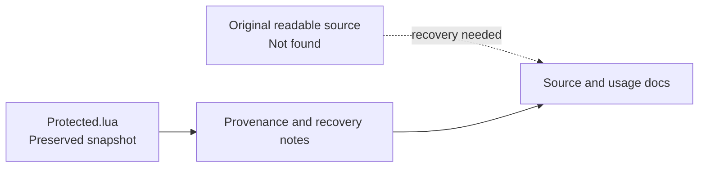

# mdhub

An obfuscated Lua snapshot preserved from `leofratu/mdhub`. Readable source was
not found in the inspected history or local locations; this snapshot is
unrecoverable from those materials without the original source.

| Start here | Purpose |
| --- | --- |
| [Protected.lua](Protected.lua) | Original artifact, unchanged at its existing path |
| [Recovery notes](docs/RECOVERY.md) | Evidence, search scope, integrity check, and recovery steps |

**Setup:** No verified runtime, dependencies, entry point, or test command is
available. Recover readable source before adding runnable setup instructions.
Project behavior and licensing are unverified; no license file was present.
